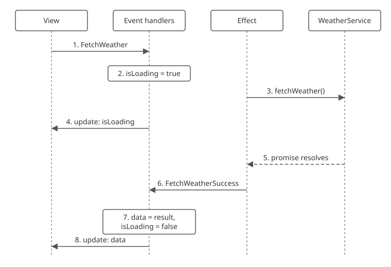

Effects and event subscriptions hold the code that does work outside the model, such as network calls and timers, so event handlers only change the model.

## Add an effect

`withEffect(eventType, effect)` adds an effect that runs after the event handlers for that event.
The effect gets the model, the event, the event context, and a `publish` function.

- The model is a frozen snapshot, taken right after the effect's own event was handled.
- `publish(eventType, event)` publishes an event to the effect's own store. To publish to another store, see [talking to other stores](./06-talking-to-other-models.md).
- If a preview handler cancels the event, its effects don't run.

The bus runs effects after the event handlers, and before observers get the update. See [state change workflow](./05-state-change-workflow.md#effects).

```typescript
import { EventBus } from 'esp-js';

type CounterModel = { count: number };

const bus = new EventBus();

bus.storeBuilder<CounterModel>('counter', { count: 0 })
    .withEventHandler('Increment', (draft) => {
        draft.count++;
    })
    .withEffect('Increment', (model) => {
        console.log('effect sees:', model.count);
    })
    .withEventHandler('IncrementTwice', () => {
        bus.publishEvent('counter', 'Increment', {});
        bus.publishEvent('counter', 'Increment', {});
    })
    .build();

bus.getStoreModelObservable<CounterModel>('counter')
    .subscribe(model => console.log('update:', model.count));

bus.publishEvent('counter', 'IncrementTwice', {});
```

Output:

```
update: 0
effect sees: 1
effect sees: 2
update: 2
```

Each effect sees the model as it was after its own `Increment` event.

## Async work through a service

Put the async call in a service, and call the service from an effect.
When the call finishes, the effect publishes an event with the result, and an event handler puts the result in the model.

{: .align-center}

1. The view publishes `FetchWeather`.
2. The event handler sets `isLoading` to `true`.
3. The effect calls `fetchWeather()` on the service, which returns a promise.
4. The view gets the model with `isLoading: true`.
5. Later, the promise resolves.
6. The effect publishes `FetchWeatherSuccess` with the data.
7. Its event handler stores the data and sets `isLoading` to `false`.
8. The view gets the model with the data.

This store is based on the weather store in the [example app](https://github.com/esp/esp-js/tree/master/examples/example-app).
It takes the service as an argument. In an esp-js-ui app, the module resolves the service from its container: see [services](../05-esp-js-ui/04-services.md).

```typescript
export type WeatherData = { temperatureCelsius: number };

export interface WeatherService {
    fetchWeather(latitude: number, longitude: number): Promise<WeatherData>;
}
```

```typescript
import type { EventBus } from 'esp-js';
import type { WeatherData, WeatherService } from './weatherService';

export type WeatherModel = {
    isLoading: boolean;
    error: string | null;
    latitude: number;
    longitude: number;
    data: WeatherData | null;
};

export const registerWeatherStore = (bus: EventBus, service: WeatherService, storeId: string): void => {
    const initialModel: WeatherModel = { isLoading: false, error: null, latitude: -31.95, longitude: 115.86, data: null };
    bus.storeBuilder<WeatherModel>(storeId, initialModel)
        .withPreviewHandler('FetchWeather', (model, event, eventContext) => {
            if (model.isLoading) {
                eventContext.cancel();
            }
        })
        .withEventHandler('FetchWeather', (draft) => {
            draft.isLoading = true;
            draft.error = null;
        })
        .withEffect('FetchWeather', (model, event, eventContext, publish) => {
            service.fetchWeather(model.latitude, model.longitude)
                .then(data => publish('FetchWeatherSuccess', data))
                .catch(() => publish('FetchWeatherError', { message: 'Failed to load weather data' }));
        })
        .withEventHandler('FetchWeatherSuccess', (draft, event: WeatherData) => {
            draft.isLoading = false;
            draft.data = event;
        })
        .withEventHandler('FetchWeatherError', (draft, event: { message: string }) => {
            draft.isLoading = false;
            draft.error = event.message;
        })
        .build();
};
```

The preview handler cancels `FetchWeather` while a fetch is already running.
With a service that returns `{ temperatureCelsius: 21 }`, an observer that logs `isLoading` and `data` prints:

```
isLoading: false data: null
isLoading: true data: null
isLoading: false data: { temperatureCelsius: 21 }
```

## Errors in effects

- If an effect throws, the bus [halts](./02-event-bus.md#errors-and-halting), as it does for a handler.
- The bus doesn't catch a rejected promise. Catch it in the effect and publish an error event, as `registerWeatherStore` does.
- If the store is removed, or the bus is disposed, before your promise resolves, `publish` throws inside your promise, and the promise rejects with that error.

## Event subscriptions

`withEventSubscription(factory)` adds code that publishes events to the store from outside, such as a timer or a socket.

- The bus calls `factory(publish)` when you call `build()`. `publish` sends events to this store.
- The factory returns a `Disposable`: an object with a `dispose()` method.
- The bus calls `dispose()` when the store is removed with `removeStore` or the bus is disposed.

```typescript
import { EventBus } from 'esp-js';

type ClockModel = { ticks: number };

const bus = new EventBus();

bus.storeBuilder<ClockModel>('clock', { ticks: 0 })
    .withEventHandler('Tick', (draft) => {
        draft.ticks++;
    })
    .withEventSubscription((publish) => {
        console.log('subscription started');
        const intervalId = setInterval(() => publish('Tick', {}), 100);
        return {
            dispose: () => {
                clearInterval(intervalId);
                console.log('subscription disposed');
            },
        };
    })
    .build();

bus.getStoreModelObservable<ClockModel>('clock')
    .subscribe(model => console.log('ticks:', model.ticks));

setTimeout(() => bus.removeStore('clock'), 250);
```

Output:

```
subscription started
ticks: 0
ticks: 1
ticks: 2
subscription disposed
```
