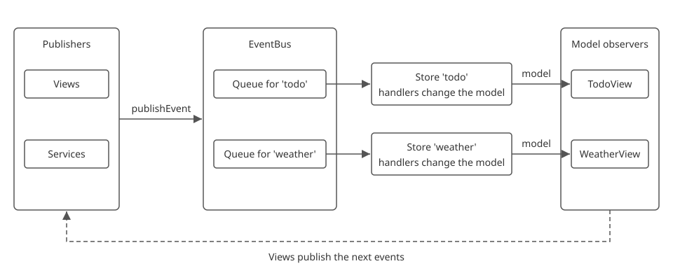

# Evented State Processor (ESP) documentation

ESP manages changes to your app's state by putting an ordered queue of events in front of each store's model.

An app has one `EventBus`, and you register your stores on it.
Views and services publish events to a store.
The store's handlers change its model one event at a time, then the bus sends the new model to the store's observers.
Because the model changes only through events, and only one event at a time, it's easy to follow and to test.

{: .align-center}

ESP v9 gives you:

* Many stores on one bus, each with its own model and observers.
* Handlers that change a draft of the model, which [immer](https://immerjs.github.io/immer/) turns into a new frozen model.
* Effects that hold side effects, such as network calls and timers, outside the handlers.
* Modules and regions with `esp-js-ui`: each module registers its stores and binds a view to each one.
* React components and hooks with `esp-js-react`, which render a store's model.
* A dependency injection container with `esp-js-di`.

For the packages and how an app fits together, see the [overview](./_docs/01-concepts/00-overview/01-index.md).


ESP was built before Redux and Flux were widely used, and it follows the same one-way flow: events go in, a new model comes out.
ESP was made for large real-time apps with many independent views, and it still targets them.



## Do you need ESP?

ESP works well if:

* You're building a large app made of many parts, possibly with several development teams.
* Your app has layers that don't depend on each other: views are grouped into modules, and modules share services.
* You're building a "micro front end" app and want to release its parts on their own.
* You have a lot of state: complex screens with 20 to 200 inputs, many workflows, or different views of the same data.
* You have real-time data and complex business logic to model.

## Where can you use ESP?

You can use ESP on the client or the server, anywhere you have complex real-time state in memory.

Your app may have several separate areas that manage complex state. Each one could be a store.

* On the client, a store can hold the state for a complex screen, or for a set of related screens.
* A store can also model things that don't have a screen: log-in flows, app bootstrapping, and notifications.
* On the server, a store can model the state you push to each user, and the server's own state.

## Talks

This [25-minute talk on ESP](https://www.youtube.com/watch?v=Pj-RakjfHDI&t=333s) at the [React London Meetup](https://meetup.react.london/) explains the core ideas. Its [slides](http://goo.gl/40jie4) are online too.
The talk and slides show the v8 APIs. To see how they map to v9, read [migrating from v8](./_docs/01-concepts/00-overview/02-migrating-from-v8.md).
